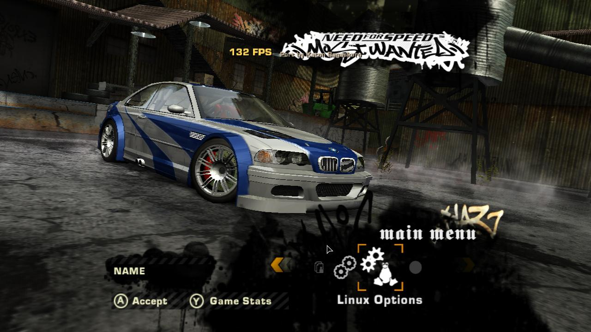
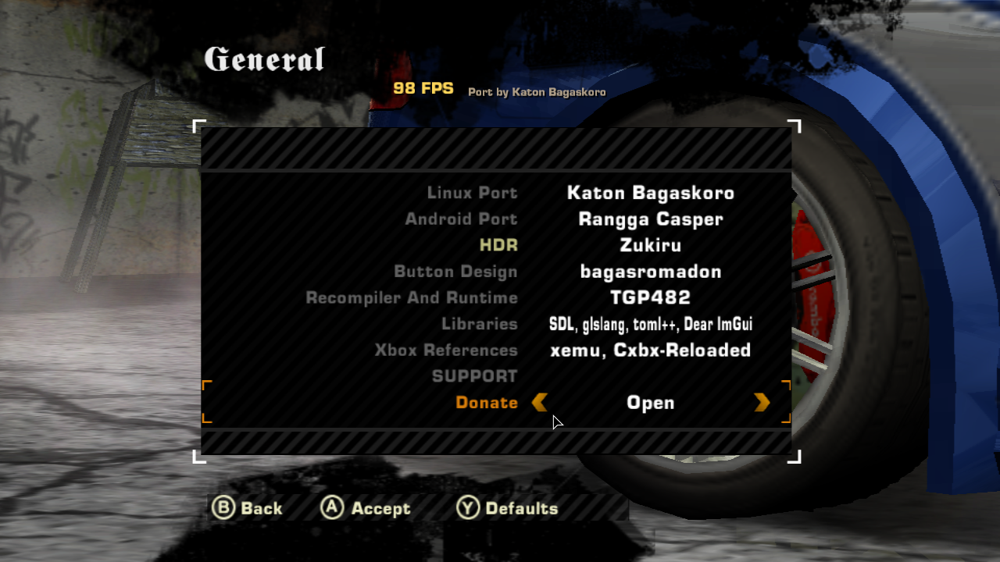
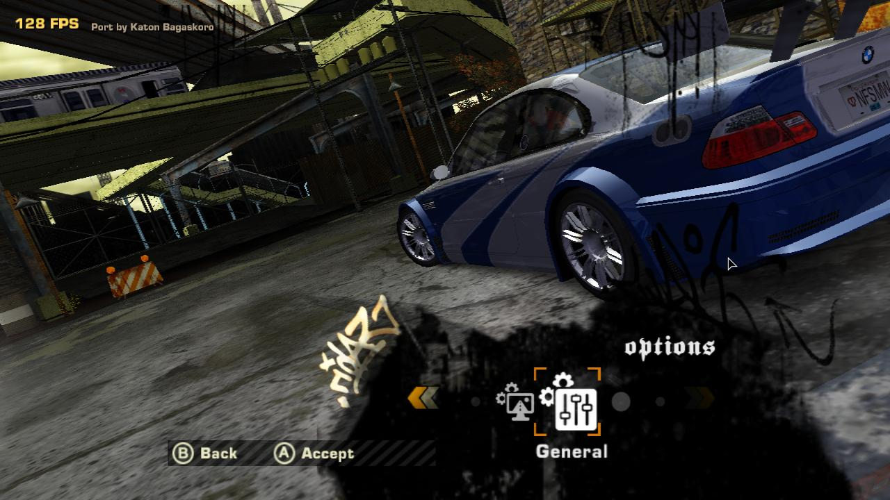
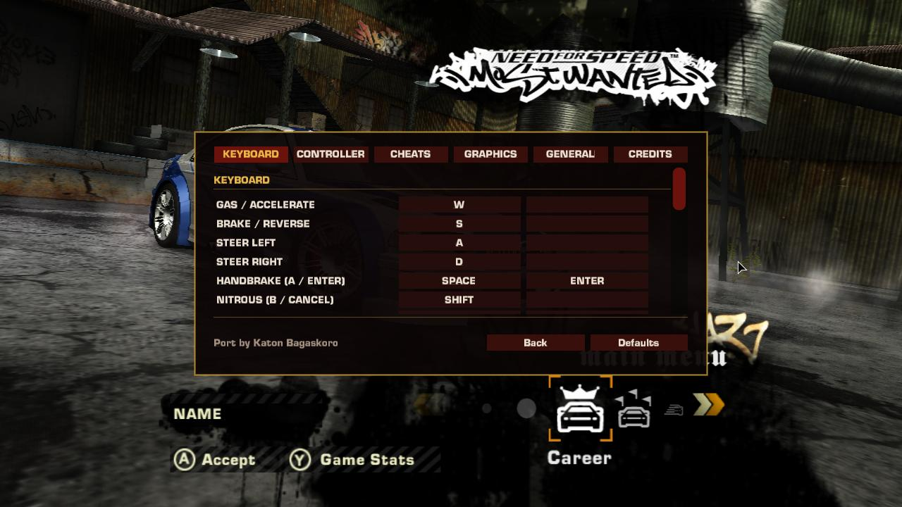
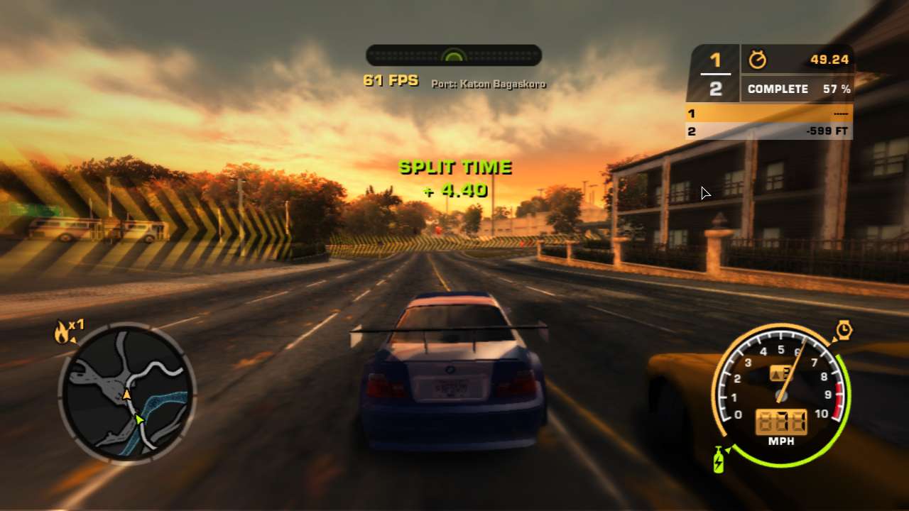
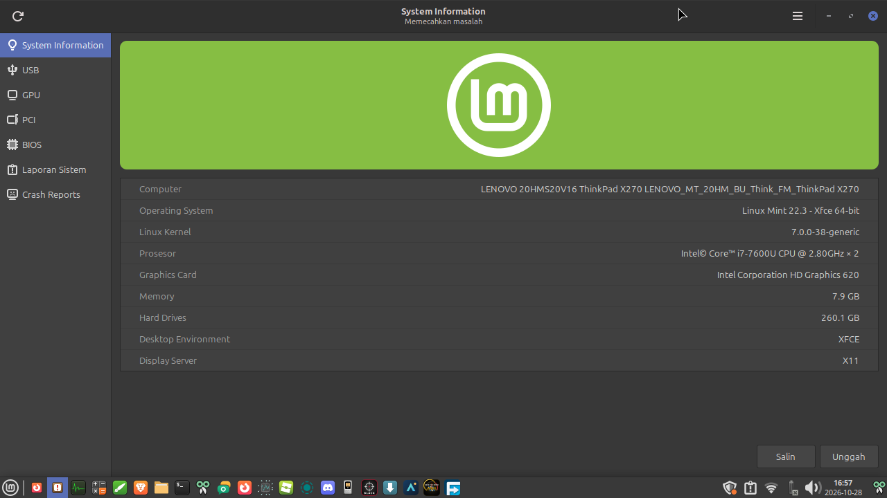
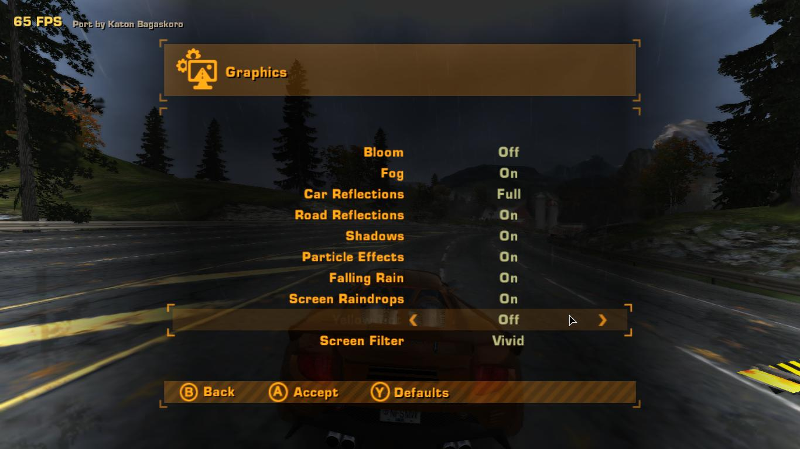
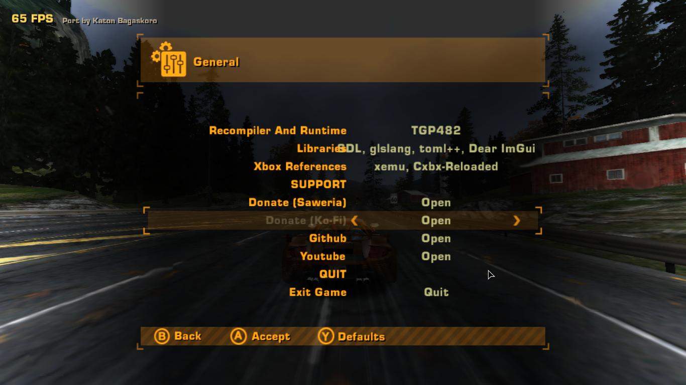

# Need for Speed: Most Wanted (Black Edition) — Port Native Linux

🇬🇧 **English version**: lihat [README.md](README.md)

[](https://github.com/Katon17/nfsmw-linux/releases)
[](https://kernel.org)
[](https://linuxmint.com)
[](https://www.vulkan.org/)
[](https://libsdl.org)
[](https://github.com/TGP482/XboxXBE-Recomp)
[](#-performa--spesifikasi-perangkat)
[](https://saweria.co/Kabako)
[](https://ko-fi.com/katonbagaskoro)

Build desktop native Linux dan paket `.deb` untuk **Need for Speed: Most Wanted (Black Edition)** (rilis Xbox original 2005). Dikelola oleh [Katon Bagaskoro (@Katon17)](https://github.com/Katon17), berbasis [MostWanted-Android milik RanggaCasper](https://github.com/RanggaCasper/MostWanted-Android) dan [XboxXBE-Recomp milik TGP482](https://github.com/TGP482/XboxXBE-Recomp).

Port native langsung menghasilkan satu biner Vulkan yang jalan di Linux tanpa emulator atau Wine. Itu kelebihan utamanya. Selain itu kita bisa langsung benerin bug engine game di kode C++ dibanding pakai memory hack di Windows.

---

## 📸 Tangkapan Layar

| New Settings Icon | General Menu, Credits, and Exit Game |
|:---:|:---:|
|  |  |

| Linux Options: Pengaturan Kontrol Dihapus | Overlay F10: Pengaturan Keyboard & Controller |
|:---:|:---:|
|  |  |

| Gameplay Balapan Prolog (Terkunci 61 FPS) | Spesifikasi Perangkat Lenovo ThinkPad X270 |
|:---:|:---:|
|  |  |

| Grafis: Toggle Filter Kuning (Yellow Tint) | Menu General: Dukungan Donasi Ko-fi & Saweria |
|:---:|:---:|
|  |  |

---

## 🎮 Cara Pasang

Paket instalasi ada di halaman releases GitHub. Kamu butuh file ISO game Xbox sendiri untuk memainkannya. Di Debian atau Mint, pasang file deb lalu jalankan gamenya. Di Steam Deck, tambahkan file AppImage sebagai non-Steam game di desktop mode.

Panduan lengkap SteamOS ada di [README-STEAM-DECK.md](README-STEAM-DECK.md).

---

## 📊 Performa & Spesifikasi Perangkat

Sudah dites jalan lancar di:
- Linux Mint
- Ubuntu
- Pop!_OS
- MX Linux
- Zorin OS
- Debian

Di ThinkPad X270 lawas (Intel HD 620), game jalan lancar di 60 FPS tanpa Wine.

---

## 🎮 Kontrol

Game ini pakai tombol WASD untuk stir dan gas, serta Spasi untuk rem tangan. Gamepad standar langsung kedeteksi otomatis. Kalau mau ganti konfigurasi tombol, tinggal tekan F10 pas game jalan.

---

## 🛠️ Kompilasi dari Source

```bash
git clone https://github.com/Katon17/nfsmw-linux.git
cd nfsmw-linux
./build-from-source.sh --deb
```

Paket `.deb` hasil kompilasi akan tersimpan di `release/nfsmw-linux_0.1.13_amd64.deb`.

---

## 🔧 Pemecahan Masalah (Troubleshooting)

Error linking di Step 3/3:
Kalau muncul undefined symbol saat compile, pastikan pakai versi v0.1.13 atau rebuild dengan:
```bash
nfsmw-linux --rebuild
```

Cutscene prolog:
Kamu bisa lewati video prolog pakai tombol Spacebar atau Enter. Kalau mau bersihkan cache shader:
```bash
nfsmw-linux --clean-cache
```

---

## 📁 Lokasi Berkas

File save dan mostwanted.toml tersimpan di `~/.local/share/nfsmw-linux`. Jadi update versi tidak akan menimpa progress career kamu.

---

## ☕ Donasi & Dukungan

* 💰 **Saweria**: [saweria.co/Kabako](https://saweria.co/Kabako)
* ☕ **Ko-fi**: [ko-fi.com/katonbagaskoro](https://ko-fi.com/katonbagaskoro)
* 📺 **YouTube**: [@KabakoNT](https://www.youtube.com/@KabakoNT)
* ⭐ **GitHub Star**: [Katon17/nfsmw-linux](https://github.com/Katon17/nfsmw-linux)

---

## 📜 Kredit & Lisensi

* **Maintainer Desktop Linux**: [Katon Bagaskoro (@Katon17)](https://github.com/Katon17)
* **Host Runtime Android Upstream**: [RanggaCasper/MostWanted-Android](https://github.com/RanggaCasper/MostWanted-Android)
* **Static Recompiler Xbox**: [TGP482/XboxXBE-Recomp](https://github.com/TGP482/XboxXBE-Recomp)
* **SpeedBreaker Project**: [SpeedBreakerProject/speedbreaker](https://github.com/SpeedBreakerProject/speedbreaker)
* **Pustaka**: [SDL3](https://github.com/libsdl-org/SDL), [glslang](https://github.com/KhronosGroup/glslang), [Dear ImGui](https://github.com/ocornut/imgui), [toml++](https://github.com/marzer/tomlplusplus), [Zydis](https://github.com/zyantific/zydis).

Need for Speed adalah merek dagang Electronic Arts. Saya tidak terafiliasi dengan EA, proyek ini dibuat untuk kesenangan dan preservasi game. Kamu butuh file ISO Xbox sendiri untuk memainkannya.
