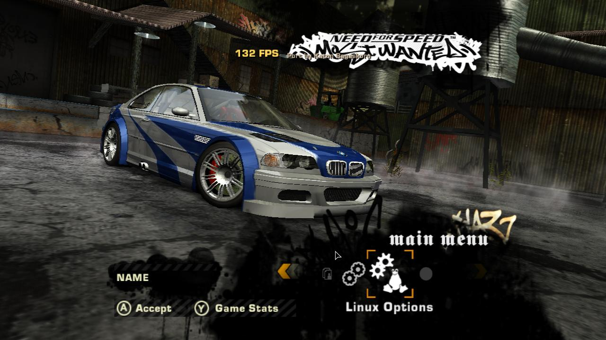
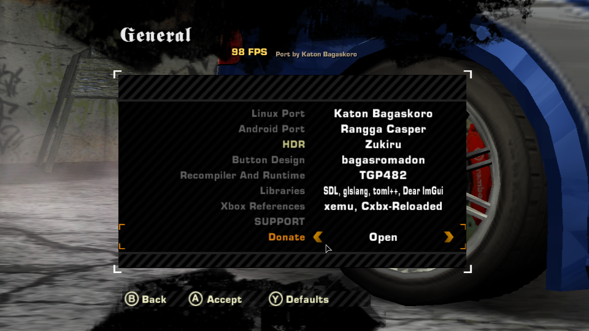
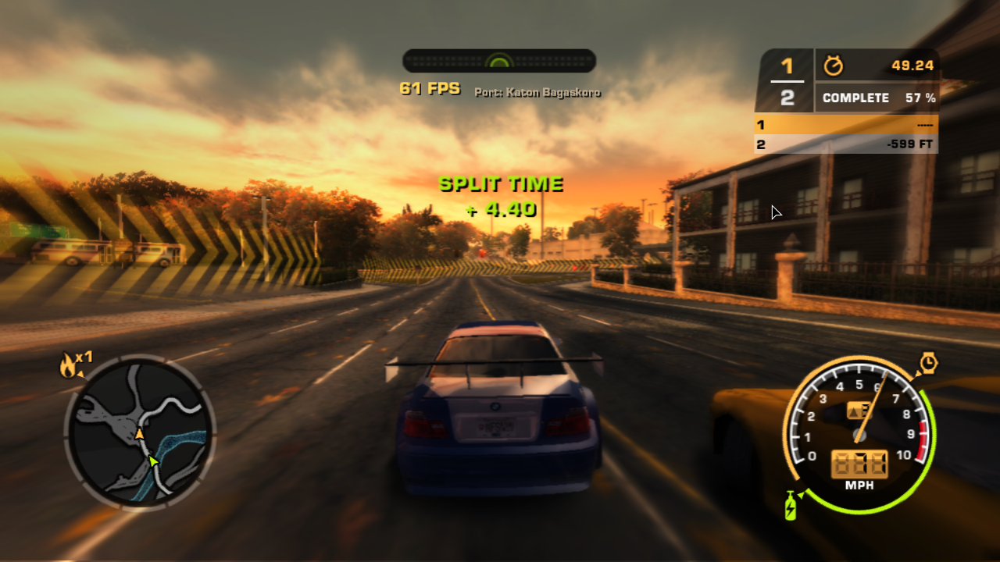
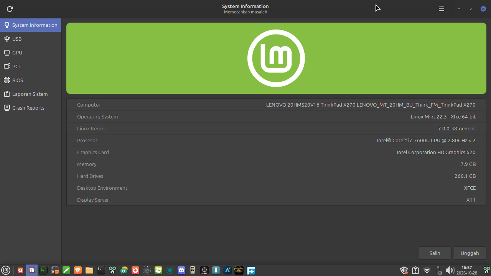

# Need for Speed: Most Wanted (Black Edition) — Port Native Linux

🇬🇧 **English version**: lihat [README.md](README.md)

[](https://github.com/Katon17/nfsmw-linux/releases)
[](https://kernel.org)
[](https://linuxmint.com)
[](https://www.vulkan.org/)
[](https://libsdl.org)
[](https://github.com/TGP482/XboxXBE-Recomp)
[](#-performa-terverifikasi--spesifikasi-sistem)
[](https://saweria.co/Kabako)

Port desktop native Linux berkinerja tinggi sekaligus paket `.deb` dari **Need for Speed: Most Wanted (Black Edition)** (2005, Xbox original), dikelola oleh [Katon Bagaskoro (@Katon17)](https://github.com/Katon17), berbasis [MostWanted-Android dari RanggaCasper](https://github.com/RanggaCasper/MostWanted-Android) dan [XboxXBE-Recomp dari TGP482](https://github.com/TGP482/XboxXBE-Recomp).

---

## 📸 Tangkapan Layar

| New Settings Icon | General Menu, Credits, and Exit Game |
|:---:|:---:|
|  |  |

| Gameplay Balapan Prolog (Terkunci 61 FPS) | Spesifikasi Perangkat Lenovo ThinkPad X270 |
|:---:|:---:|
|  |  |

---

## ⚡ Mengapa Port Native Ini?

Metode tradisional menjalankan game klasik konsol di Linux menderita beban performa yang parah:
- **Emulator (Xemu, RPCS3, PCSX2)**: Mengemulasi CPU instruksi demi instruksi dan mensimulasikan register GPU dalam loop perangkat lunak. Pada laptop dual-core kelas bawah seperti **ThinkPad X270 (Intel Core i5/i7 Generasi ke-7, Intel HD 620)**, emulator hanya mampu 15–25 FPS dengan suara yang patah-patah.
- **Wine / Proton**: Menambahkan lapisan terjemahan DXVK, shim API Windows, dan konsumsi memori latar yang berat.

**`nfsmw-linux` mengambil pendekatan rekompilasi murni native**:
1. **Rekompilasi Statis**: Menerjemahkan langsung instruksi assembly x86 Xbox original dari `default.xbe` menjadi kode C++ modern secara ahead-of-time.
2. **Host Vulkan 1.1 Langsung**: Menerjemahkan draw call Direct3D 8, stream DirectSound, dan primitif sinkronisasi kernel langsung menjadi **Vulkan 1.1** bare-metal, audio **SDL3**, dan thread POSIX Linux.
3. **Tanpa Lapisan Emulasi**: Berjalan sebagai biner ELF 64-bit Linux (`x86_64`) native yang sesungguhnya di atas bare metal.
4. **100+ FPS di Laptop Kelas Bawah**: Memberikan frame rate yang mulus dan kontrol yang responsif bahkan pada grafis terintegrasi 15W low-power (Intel HD 620).

---

## 🆕 Yang Baru & Changelog

### Versi 0.1.4 (Terbaru)
- **Tautan Resmi Pengembang (Support & Media)**:
  - Menu **General > SUPPORT** kini langsung terhubung ke profil resmi [Katon Bagaskoro](https://github.com/Katon17):
    - **DONATE**: [Saweria (saweria.co/Kabako)](https://saweria.co/Kabako)
    - **GITHUB**: [Katon17/nfsmw-linux](https://github.com/Katon17/nfsmw-linux)
    - **YOUTUBE**: [@KabakoNT (youtube.com/@KabakoNT)](https://www.youtube.com/@KabakoNT)
- **Fitur Baru "EXIT GAME" (Keluar Game)**:
  - Menambahkan menu `EXIT GAME` di dalam opsi **General** dan overlay **F10** untuk menutup permainan secara bersih ke desktop Linux (mem-flush log, membebaskan memori Vulkan/SDL3 tanpa meninggalkan proses *zombie*).
  - Tersedia terjemahan otomatis dalam Bahasa Indonesia (`Keluar Game` ➔ `Keluar`) dan berbagai bahasa lainnya.
- **Kredit Tim (Dual Port Credits)**:
  - Menyempurnakan daftar **Credits** dengan mengapresiasi **Rangga Casper** sebagai pembuat port Android asal, dan **Katon Bagaskoro** sebagai pengembang port native Linux.
- **Tampilan Antarmuka Khusus Linux (Linux Options & Ikon Tux)**:
  - Opsi di menu utama kini bertuliskan **"Linux Options"** (atau **"Opsi Linux"**).
  - Mengganti ikon robot Android dengan ikon custom **Tux the Linux Penguin** bersanding dengan roda gigi pengaturan dalam gaya monokrom khas Need for Speed.
- **Perbaikan Masalah Linking Step `[3/3]` (Ernawan's Fix)**:
  - Mengimplementasikan *weak symbols* (`__attribute__((weak))`) dan argumen linker `-Wl,--allow-multiple-definition`.
  - Menghilangkan sepenuhnya error *duplicate symbol* maupun *undefined symbol* (`input::PadActions`, `host::SamplePerf`).
- **Perbaikan Freeze / Stuck Loading Prologue Race 2 (Yokaiju's Fix)**:
  - Mengatasi *deadlock* Vulkan fence saat transisi balapan mengalahkan SLR McLaren hitam (Bull) dengan pembatasan timeout 5 detik (`kGpuWaitTimeoutNs`).
  - Mengganti `Destroy(down)` menjadi `Retire(down)` agar tekstur transfer in-flight tidak terhapus prematur saat GPU masih membaca data.
  - Mengaktifkan fitur lewati video cutscene transisi secara manual kapan saja dengan tombol **Enter** atau **Spacebar** / Controller **A**.
  - Membersihkan partisi scratch cache sementara Xbox (`hdd/X`, `hdd/Y`, `hdd/Z`) secara otomatis pada setiap boot game tanpa menyentuh progress save karier (`hdd/E/UDATA`).

---

## 📊 Performa Terverifikasi & Spesifikasi Sistem

### Benchmark Testbed Dunia Nyata
Diuji pada perangkat keras asli oleh **Katon Bagaskoro**:
* **Laptop**: Lenovo ThinkPad X270
* **CPU**: Intel® Core™ i7-7600U @ 2.80GHz (2 Core / 4 Thread, 15W ULV)
* **GPU**: Intel® HD Graphics 620 (driver Mesa Vulkan)
* **RAM**: 8 GB DDR4
* **OS**: Linux Mint 22.3 (XFCE 64-bit, Kernel 6.8 / 7.0)
* **Performa dalam Game**: **104 – 121 FPS di Menu, Terkunci 60 – 61 FPS di Gameplay** pada resolusi native dengan tanpa stuttering, tanpa suara berderak, dan respons input instan.

---

### Kebutuhan Perangkat Keras

Berdasarkan pengujian empiris pada ThinkPad X270, berikut kebutuhan perangkat keras minimum dan yang direkomendasikan:

| Spesifikasi | Minimum (30–45 FPS dapat dimainkan) | Direkomendasikan (Terkunci 60–120 FPS) |
|---|---|---|
| **Sistem Operasi** | Linux Mint 21/22, Ubuntu 22.04/24.04, Debian 12, Arch, Fedora | Linux Mint 22.3 XFCE / Ubuntu 24.04 LTS (x86_64) |
| **Prosesor (CPU)** | Intel Core i3 Generasi ke-4 (Haswell) / Celeron G3900 / AMD Athlon 200GE *(Harus mendukung `x86-64-v2` / SSE4.2)* | Intel Core i5 / i7 Generasi ke-6 atau ke-7 (mis. i7-7600U, i5-7200U) atau AMD Ryzen 3 2200U / Ryzen 5 |
| **Grafis (GPU)** | Intel HD Graphics 4400 / 520, AMD Radeon R5 / HD 7000, NVIDIA GT 730 *(wajib mendukung Vulkan 1.1)* | Intel HD Graphics 620 / Intel Iris Xe / AMD Vega 3+ / NVIDIA GeForce 940MX atau GPU dedicated |
| **RAM** | 4 GB | 8 GB (mempercepat kompilasi C++ awal satu kali) |
| **Penyimpanan** | ~4 GB ruang tersedia (data game + cache) | Penyimpanan SSD direkomendasikan |

---

## 🚀 Instalasi Cepat (Debian / Linux Mint / Ubuntu)

Tidak memerlukan keahlian terminal. Instalasi sepenuhnya otomatis:

### 1. Unduh & Instal Paket `.deb`
Unduh rilis terbaru **`nfsmw-linux_0.1.4_amd64.deb`** dari halaman [GitHub Releases](https://github.com/Katon17/nfsmw-linux/releases):

* **Opsi GUI**: Klik dua kali file `.deb` yang diunduh, lalu klik **Install Package** di GDebi atau Software Manager.
* **Opsi Terminal**:
  ```bash
  sudo apt install ./nfsmw-linux_0.1.4_amd64.deb
  ```

Semua dependensi yang diperlukan (`libvulkan1`, `mesa-vulkan-drivers`, `clang`, `lld`, `zenity`, `python3`) diinstal secara otomatis.

### 2. Jalankan & Pilih ISO Anda
1. Buka menu aplikasi desktop Anda: **Menu ➔ Games ➔ Need for Speed: Most Wanted**.
2. Dialog pemilihan file akan muncul: pilih image disc ISO Xbox original Anda dari **Need for Speed: Most Wanted (Black Edition - USA)**.
3. Builder otomatis akan:
   - Mengekstrak `default.xbe` menggunakan pembaca XDVDFS bawaan.
   - Merekompilasi 28.848 fungsi game menjadi C++.
   - Mengompilasi modul dan menautkan eksekutor native Linux.
   - Mengkonfigurasi otomatis kontrol balap WASD yang optimal.
4. Game langsung berjalan!

*(Peluncuran berikutnya terbuka dalam 2 detik langsung ke dalam game tanpa rekompilasi).*

---

## 🎮 Kontrol

### Keyboard (Skema Balap PC WASD Murni)

Kontrol sudah dikonfigurasi sejak awal agar sesuai tata letak PC Need for Speed kanonik tanpa konflik tombol:

| Aksi | Tombol | Deskripsi |
|---|:---:|---|
| **Gas / Akselerasi** | `W` | Pedal gas utama (Right Trigger) |
| **Rem / Mundur** | `S` | Rem kaki dan mundur (Left Trigger) |
| **Belok Kiri** | `A` | Putar roda ke kiri (Analog stick) |
| **Belok Kanan** | `D` | Putar roda ke kanan (Analog stick) |
| **Handbrake / Drift** | `Spacebar` | Rem tangan untuk power slide dan tikungan tajam |
| **Nitrous (NOS)** | `Left Shift` | Boost nitrous oksida |
| **Speedbreaker** | `X` | Slow motion bullet-time |
| **Lihat Belakang (Rear View)** | `C` | Melihat ke belakang mobil |
| **Ganti Kamera** | `V` | Beralih antara Bumper, Hood, Chase Close, dan Chase Far |
| **Klakson** | `H` | Membunyikan klakson |
| **Reset Mobil** | `R` | Mengembalikan kendaraan ke jalan |
| **Jeda Game** | `Escape` | Menu jeda |
| **Navigasi Menu** | `Tombol Panah` | Menelusuri opsi menu dengan aman |
| **Pilih / Enter** | `Enter` | Mengkonfirmasi pilihan |
| **Menu Pengaturan Port** | `F10` | Menu overlay dalam game (rebind tombol, lihat FPS, sesuaikan grafis) |

### Gamepad (Xbox, PlayStation, USB Generik)
Dukungan controller plug-and-play melalui SDL3:
- **Gas / Akselerasi**: Right Trigger (`RT` / `R2`)
- **Rem / Mundur**: Left Trigger (`LT` / `L2`)
- **Belok**: Left Analog Stick
- **Handbrake**: `A` (Xbox) / `Cross` (PlayStation)
- **Nitrous**: `B` (Xbox) / `Circle` (PlayStation)
- **Speedbreaker**: `X` (Xbox) / `Square` (PlayStation)
- **Lihat Belakang**: `Y` (Xbox) / `Triangle` (PlayStation)
- **Jeda**: `Start` / `Options`

---

## 🛠️ Membangun dari Sumber

Jika Anda ingin memodifikasi runtime host atau membangun dari sumber:

```bash
# 1. Clone repositori
git clone https://github.com/Katon17/nfsmw-linux.git
cd nfsmw-linux

# 2. Bangun library host, recompiler, dan paket
./build-from-source.sh --deb
```

Paket yang dihasilkan akan dibuat di `release/nfsmw-linux_0.1.4_amd64.deb`.

---

## 🔧 Pemecahan Masalah & Solusi Masalah Populer

### 1. Linking Gagal pada Step `[3/3]` (`undefined symbol` / `duplicate symbol`)
* **Penyebab**: Terjadi konflik simbol stub antara library host dan linker pada sistem tertentu.
* **Solusi di v0.1.4**: Seluruh stub input dan host telemetry telah di-bake secara internal langsung di `libnfsmw_host.a` dengan *weak symbols* dan linker flag `--allow-multiple-definition`. Cukup install update:
  ```bash
  sudo dpkg -i nfsmw-linux_0.1.4_amd64.deb
  nfsmw-linux --rebuild
  ```

### 2. Freeze / Stuck Loading setelah Mengalahkan SLR McLaren Hitam (Prologue Race 2)
* **Penyebab**: 
  1. Vulkan Fence deadlock (`UINT64_MAX` menunggu GPU tak terhingga saat transisi FMV/cutscene ke race berikutnya).
  2. Partisi cache sementara Xbox (`hdd/X`, `hdd/Y`, `hdd/Z`) menyimpan dump sementara yang korup saat transisi loading.
  3. Pemutaran FMV transisi tidak merespons tombol lewati (*skip*).
* **Solusi di v0.1.4**:
  - Vulkan fence timeout dibatasi maksimal 5 detik (`kGpuWaitTimeoutNs`) untuk mencegah GPU hang tanpa henti.
  - Penanganan transfer image Vulkan di-upgrade ke `Retire(down)` agar tekstur in-flight tidak terhapus prematur.
  - Cutscene transisi kini dapat dilewati secara manual kapan saja dengan menekan **Enter** atau **Spacebar** / Gamepad **A**.
  - Partisi scratch cache Xbox (`X`, `Y`, `Z`) dibersihkan otomatis pada setiap boot game tanpa menyentuh progress save karier (`hdd/E/UDATA`).
  - Pembersihan cache shader manual dapat dijalankan dengan:
    ```bash
    nfsmw-linux --clean-cache
    ```

---

## 📁 Lokasi File

* **Simpanan Game & Profil Karier**: `~/.local/share/nfsmw-linux/hdd/` (penyimpanan virtual Xbox, aman antar pembaruan)
* **File Konfigurasi**: `~/.local/share/nfsmw-linux/mostwanted.toml`
* **Cache Shader Vulkan**: `~/.local/share/nfsmw-linux/mesa_cache/`
* **Biner Game Terkompilasi**: `~/.local/share/nfsmw-linux/bin/MOSTWANTED`

---

## ☕ Dukungan & Donasi

Jika proyek ini bermanfaat bagi Anda dan komunitas Linux gaming, Anda dapat mendukung pengembangannya melalui:
* 💰 **Saweria**: [saweria.co/Kabako](https://saweria.co/Kabako)
* 📺 **YouTube**: [@KabakoNT](https://www.youtube.com/@KabakoNT)
* ⭐ **GitHub Star**: [Katon17/nfsmw-linux](https://github.com/Katon17/nfsmw-linux)

---

## 📜 Kredit & Pengakuan

* **Maintainer Desktop Linux**: [Katon Bagaskoro (@Katon17)](https://github.com/Katon17)
* **Runtime Host Android Hulu**: [RanggaCasper/MostWanted-Android](https://github.com/RanggaCasper/MostWanted-Android)
* **Recompiler Statis Xbox**: [TGP482/XboxXBE-Recomp](https://github.com/TGP482/XboxXBE-Recomp)
* **Proyek SpeedBreaker**: [SpeedBreakerProject/speedbreaker](https://github.com/SpeedBreakerProject/speedbreaker)
* **Library**: [SDL3](https://github.com/libsdl-org/SDL), [glslang](https://github.com/KhronosGroup/glslang), [Dear ImGui](https://github.com/ocornut/imgui), [toml++](https://github.com/marzer/tomlplusplus), [Zydis](https://github.com/zyantific/zydis).

*Disclaimer: Need for Speed™ dan Need for Speed: Most Wanted adalah merek dagang terdaftar milik Electronic Arts Inc. Ini adalah proyek pelestarian open-source non-resmi dan non-komersial. Tidak ada biner atau aset berhak cipta EA yang didistribusikan.*
