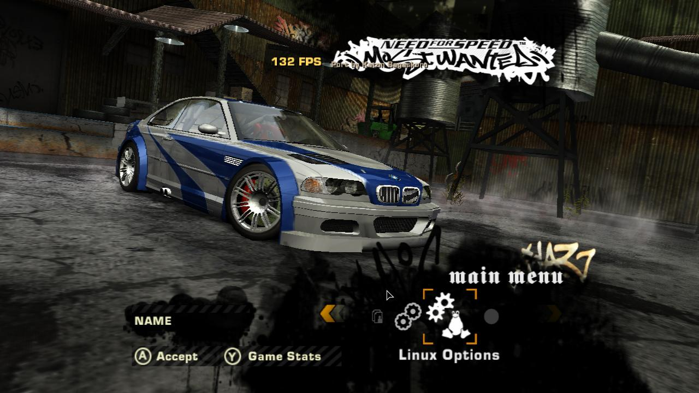
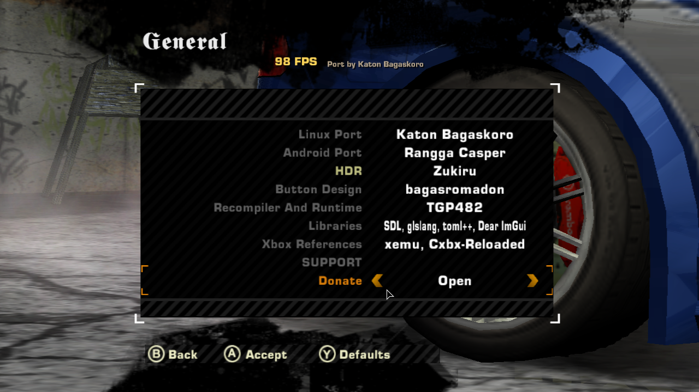
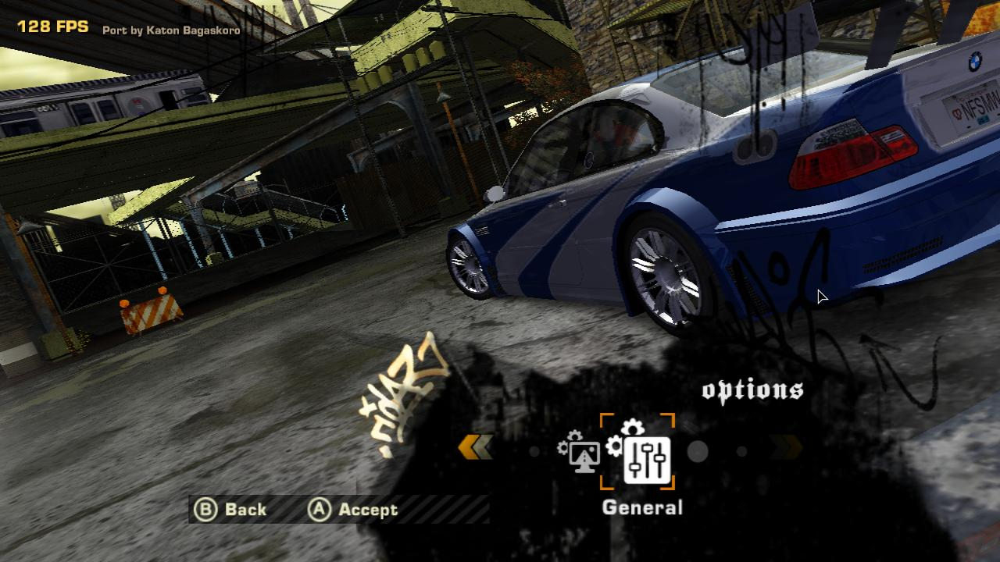
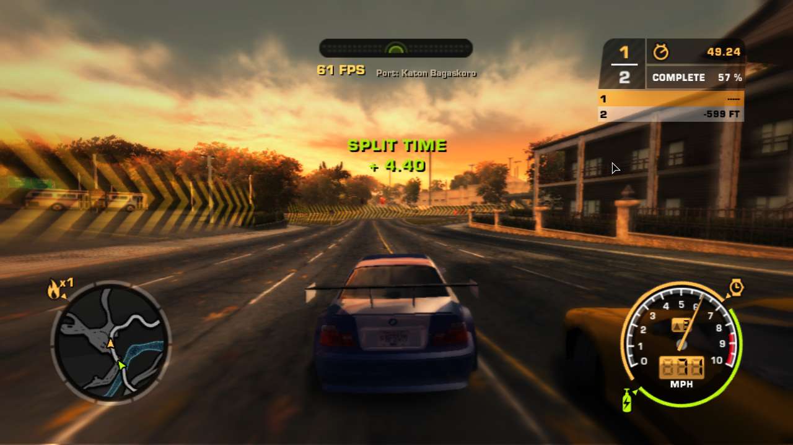
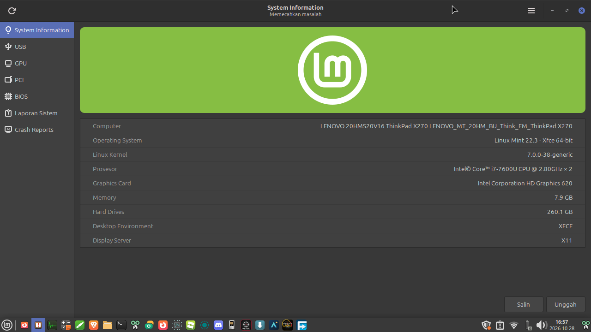
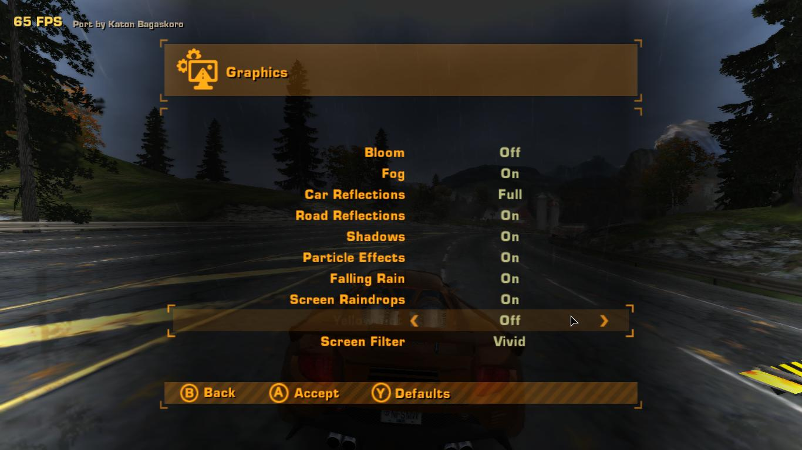
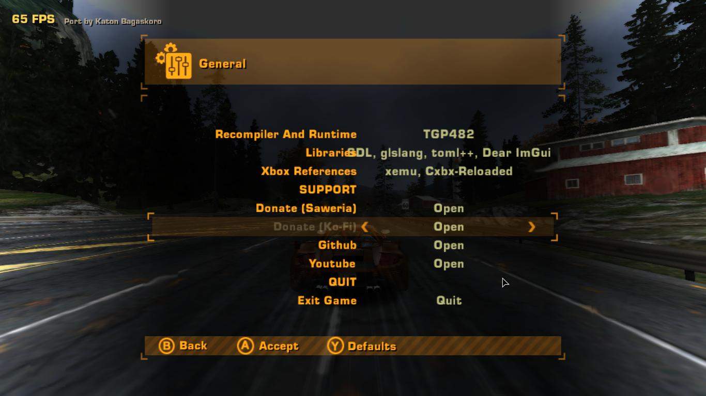

# Need for Speed: Most Wanted (Black Edition) — Native Linux Port

🇮🇩 **Bahasa Indonesia**: lihat [README.id.md](README.id.md)

[](https://github.com/Katon17/nfsmw-linux/releases)
[](https://kernel.org)
[](https://linuxmint.com)
[](https://www.vulkan.org/)
[](https://libsdl.org)
[](https://github.com/TGP482/XboxXBE-Recomp)
[](#-performance--hardware)
[](https://saweria.co/Kabako)
[](https://ko-fi.com/katonbagaskoro)

Native Linux desktop build and `.deb` package of **Need for Speed: Most Wanted (Black Edition)** (2005 original Xbox release). Maintained by [Katon Bagaskoro (@Katon17)](https://github.com/Katon17), based on [RanggaCasper's MostWanted-Android](https://github.com/RanggaCasper/MostWanted-Android) and [TGP482's XboxXBE-Recomp](https://github.com/TGP482/XboxXBE-Recomp).

A native port gives you a single Vulkan binary that runs on Linux directly. That is pretty much the main benefit. Also we can fix original engine bugs in the C++ code instead of relying on memory hacks or DLL injection on Windows.

---

## 📸 Screenshots

| New Settings Icon | General Menu, Credits, and Exit Game |
|:---:|:---:|
|  |  |

| Linux Options: Control Settings Removed | F10 Overlay: Keyboard & Controller Settings |
|:---:|:---:|
|  |  |

| Gameplay Prologue Race (Locked 61 FPS) | Lenovo ThinkPad X270 Hardware Specs |
|:---:|:---:|
|  |  |

| Graphics: Yellow Tint Toggle | General Menu: Ko-fi & Saweria Support |
|:---:|:---:|
|  |  |

---

## 🎮 Installation

Builds are available under releases on GitHub. You will need your own Xbox game ISO to build it. On Debian or Mint, install the deb file and launch the game. On Steam Deck, add the AppImage as a non-Steam game in desktop mode.

Check [README-STEAM-DECK.md](README-STEAM-DECK.md) for SteamOS details.

---

## 📊 Performance & Hardware

Tested and working on:
- Linux Mint
- Ubuntu
- Pop!_OS
- MX Linux
- Zorin OS
- Debian

Running native on an old ThinkPad X270 (HD 620) at 60 FPS without Wine.

---

## 🎮 Controls

The game uses WASD for driving and Spacebar for the handbrake. Standard gamepads are supported natively. If you want to change button bindings, press F10 while playing.

---

## 🛠️ Building from Source

```bash
git clone https://github.com/Katon17/nfsmw-linux.git
cd nfsmw-linux
./build-from-source.sh --deb
```

The resulting package will be generated at `release/nfsmw-linux_0.1.13_amd64.deb`.

---

## 🔧 Troubleshooting

Step 3/3 linking errors:
If you see undefined symbols during compilation, make sure you are on v0.1.13 or rebuild with:
```bash
nfsmw-linux --rebuild
```

Prologue cutscene:
You can skip the prologue cutscene with Spacebar or Enter. You can also clear shader cache with:
```bash
nfsmw-linux --clean-cache
```

---

## 📁 File Locations

Save games and mostwanted.toml are placed under `~/.local/share/nfsmw-linux`. You do not have to worry about updates overwriting your career progress.

---

## ☕ Support & Donations

* 💰 **Saweria**: [saweria.co/Kabako](https://saweria.co/Kabako)
* ☕ **Ko-fi**: [ko-fi.com/katonbagaskoro](https://ko-fi.com/katonbagaskoro)
* 📺 **YouTube**: [@KabakoNT](https://www.youtube.com/@KabakoNT)
* ⭐ **GitHub Star**: [Katon17/nfsmw-linux](https://github.com/Katon17/nfsmw-linux)

---

## 📜 Credits & Disclaimer

* **Linux Desktop Maintainer**: [Katon Bagaskoro (@Katon17)](https://github.com/Katon17)
* **Upstream Android Host Runtime**: [RanggaCasper/MostWanted-Android](https://github.com/RanggaCasper/MostWanted-Android)
* **Xbox Static Recompiler**: [TGP482/XboxXBE-Recomp](https://github.com/TGP482/XboxXBE-Recomp)
* **SpeedBreaker Project**: [SpeedBreakerProject/speedbreaker](https://github.com/SpeedBreakerProject/speedbreaker)
* **Libraries**: [SDL3](https://github.com/libsdl-org/SDL), [glslang](https://github.com/KhronosGroup/glslang), [Dear ImGui](https://github.com/ocornut/imgui), [toml++](https://github.com/marzer/tomlplusplus), [Zydis](https://github.com/zyantific/zydis).

Need for Speed is a trademark of Electronic Arts. I am not affiliated with EA, just made this for fun as an unofficial preservation project. You will need your own Xbox game ISO to build it.
