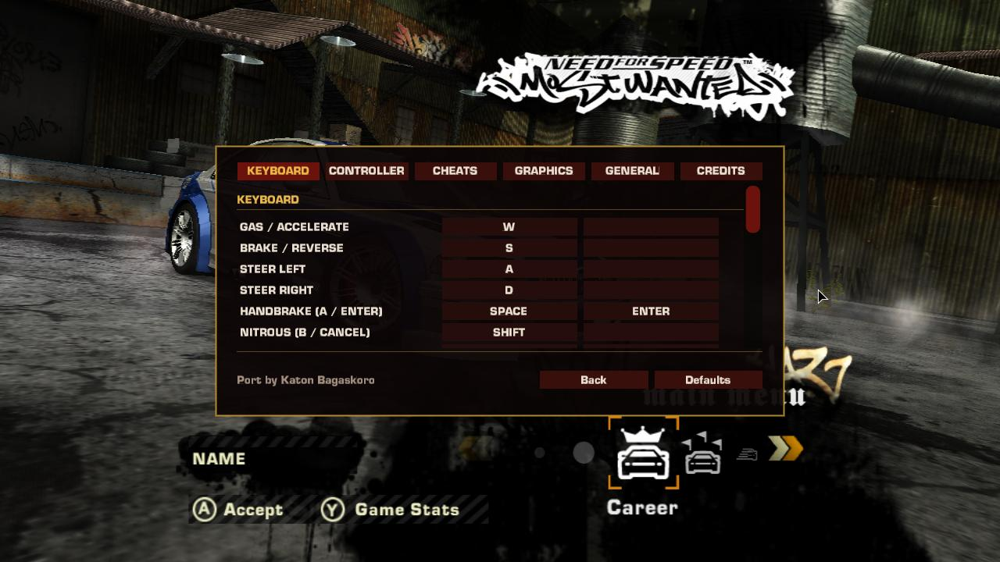

# Need for Speed: Most Wanted (Black Edition) — Native Linux Port

🇮🇩 **Bahasa Indonesia**: lihat [README.id.md](README.id.md)

[](https://github.com/Katon17/nfsmw-linux/releases)
[](https://kernel.org)
[](https://linuxmint.com)
[](https://www.vulkan.org/)
[](https://libsdl.org)
[](https://github.com/TGP482/XboxXBE-Recomp)
[](#-performance--hardware)
[](https://saweria.co/Kabako)
[](https://ko-fi.com/katonbagaskoro)

Native Linux desktop build and `.deb` package of **Need for Speed: Most Wanted (Black Edition)** (2005 original Xbox release). Maintained by [Katon Bagaskoro (@Katon17)](https://github.com/Katon17), based on [RanggaCasper's MostWanted-Android](https://github.com/RanggaCasper/MostWanted-Android) and [TGP482's XboxXBE-Recomp](https://github.com/TGP482/XboxXBE-Recomp).

A native port gives you a single Vulkan binary that runs on Linux directly. That is pretty much the main benefit. Also we can fix original engine bugs in the C++ code instead of relying on memory hacks or DLL injection on Windows.

---

## 📸 Screenshots

| New Settings Icon | General Menu, Credits, and Exit Game |
|:---:|:---:|
|  |  |

| Linux Options: Control Settings Removed | F10 Overlay: Keyboard & Controller Settings |
|:---:|:---:|
|  |  |

| Gameplay Prologue Race (Locked 61 FPS) | Lenovo ThinkPad X270 Hardware Specs |
|:---:|:---:|
|  |  |

| Graphics: Yellow Tint Toggle | General Menu: Ko-fi & Saweria Support |
|:---:|:---:|
|  |  |

---

## 🎮 Installation

### Linux Mint / Ubuntu / Debian (.deb)
I uploaded a `.deb` on GitHub releases if you want to test it. You can just install it from your file manager and pick your Xbox ISO when it prompts you.

Terminal install:
```bash
sudo apt install ./nfsmw-linux_0.1.13_amd64.deb
```
Then launch Need for Speed from your desktop application menu under **Games**.

### Steam Deck & SteamOS
I put together an AppImage and tarball for Steam Deck. You can find them under releases on GitHub. Add the file as a non-Steam shortcut in desktop mode. Gaming mode runs fine at 60 FPS and you don't have to fiddle with controls. It also uses KDialog for picking the ISO file.

Check [README-STEAM-DECK.md](README-STEAM-DECK.md) for details.

---

## 📊 Performance & Hardware

Tested and working on:
- Linux Mint
- Ubuntu
- Pop!_OS
- MX Linux
- Zorin OS
- Debian

Running native on an old ThinkPad X270 (HD 620) at 60 FPS without Wine.

| Specification | Minimum | Recommended |
|---|---|---|
| **Operating System** | Linux Mint, Ubuntu, Debian, Arch, Fedora | Linux Mint 22.3 XFCE / Ubuntu 24.04 (x86_64) |
| **Processor (CPU)** | Intel Core i3 4th Gen / AMD Athlon (SSE4.2 required) | Intel Core i5 / i7 or AMD Ryzen |
| **Graphics (GPU)** | Intel HD 4400 / 520, AMD Radeon R5 (Vulkan 1.1 required) | Intel HD 620 / Iris Xe / AMD Vega / dedicated GPU |
| **RAM** | 4 GB | 8 GB |
| **Storage** | ~4 GB available space | SSD |

---

## 🎮 Controls

### Keyboard (WASD)

| Action | Key | Description |
|---|:---:|---|
| **Throttle / Accelerate** | `W` | Gas pedal |
| **Brake / Reverse** | `S` | Foot brake and reverse |
| **Steer Left** | `A` | Steer left |
| **Steer Right** | `D` | Steer right |
| **Handbrake / Drift** | `Spacebar` | E-brake |
| **Shift Up (Drag / Manual)** | `Page Up` / `Numpad 8` | Shift up |
| **Shift Down (Drag / Manual)** | `Page Down` / `Numpad 5` | Shift down |
| **Nitrous (NOS)** | `Left Shift` | Nitrous oxide |
| **Speedbreaker** | `X` | Slow motion |
| **Look Back** | `C` | Rear view camera |
| **Change Camera** | `V` | Switch camera angle |
| **Horn** | `H` | Honk horn |
| **Reset Car** | `R` | Reset car to track |
| **Pause Game** | `Escape` | Pause menu |
| **Navigate Menus** | `Arrow Keys` | Menu navigation |
| **Select / Enter** | `Enter` | Confirm selection |
| **Overlay Settings** | `F10` | Rebind keys and adjust graphics |

### Gamepads (Xbox, PlayStation, USB)
Plug-and-play controller support via SDL3:
- **Accelerate**: Right Trigger (`RT` / `R2`)
- **Brake / Reverse**: Left Trigger (`LT` / `L2`)
- **Steer**: Left Stick
- **Shift Up / Down**: Right Stick Up / Down
- **Handbrake**: `A` (Xbox) / `Cross` (PlayStation)
- **Nitrous**: `B` (Xbox) / `Circle` (PlayStation)
- **Speedbreaker**: `X` (Xbox) / `Square` (PlayStation)
- **Look Back**: `Y` (Xbox) / `Triangle` (PlayStation)
- **Pause**: `Start` / `Options`

---

## 🛠️ Building from Source

```bash
git clone https://github.com/Katon17/nfsmw-linux.git
cd nfsmw-linux
./build-from-source.sh --deb
```

The resulting package will be generated at `release/nfsmw-linux_0.1.13_amd64.deb`.

---

## 🔧 Troubleshooting

Step 3/3 linking errors:
If you see undefined symbols during compilation, make sure you are on v0.1.13 or rebuild with:
```bash
nfsmw-linux --rebuild
```

Prologue cutscene:
You can skip the prologue cutscene with Spacebar or Enter. You can also clear shader cache with:
```bash
nfsmw-linux --clean-cache
```

---

## 📁 File Locations

* **Game Saves & Career Profiles**: `~/.local/share/nfsmw-linux/hdd/`
* **Configuration File**: `~/.local/share/nfsmw-linux/mostwanted.toml`
* **Vulkan Shader Cache**: `~/.local/share/nfsmw-linux/mesa_cache/`
* **Compiled Game Binary**: `~/.local/share/nfsmw-linux/bin/MOSTWANTED`

---

## ☕ Support & Donations

* 💰 **Saweria**: [saweria.co/Kabako](https://saweria.co/Kabako)
* ☕ **Ko-fi**: [ko-fi.com/katonbagaskoro](https://ko-fi.com/katonbagaskoro)
* 📺 **YouTube**: [@KabakoNT](https://www.youtube.com/@KabakoNT)
* ⭐ **GitHub Star**: [Katon17/nfsmw-linux](https://github.com/Katon17/nfsmw-linux)

---

## 📜 Credits & Disclaimer

* **Linux Desktop Maintainer**: [Katon Bagaskoro (@Katon17)](https://github.com/Katon17)
* **Upstream Android Host Runtime**: [RanggaCasper/MostWanted-Android](https://github.com/RanggaCasper/MostWanted-Android)
* **Xbox Static Recompiler**: [TGP482/XboxXBE-Recomp](https://github.com/TGP482/XboxXBE-Recomp)
* **SpeedBreaker Project**: [SpeedBreakerProject/speedbreaker](https://github.com/SpeedBreakerProject/speedbreaker)
* **Libraries**: [SDL3](https://github.com/libsdl-org/SDL), [glslang](https://github.com/KhronosGroup/glslang), [Dear ImGui](https://github.com/ocornut/imgui), [toml++](https://github.com/marzer/tomlplusplus), [Zydis](https://github.com/zyantific/zydis).

Need for Speed is a trademark of Electronic Arts. I am not affiliated with EA, just made this for fun as an unofficial preservation project. You will need your own Xbox game ISO to build it.
