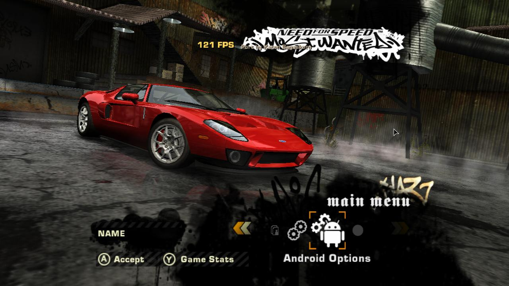
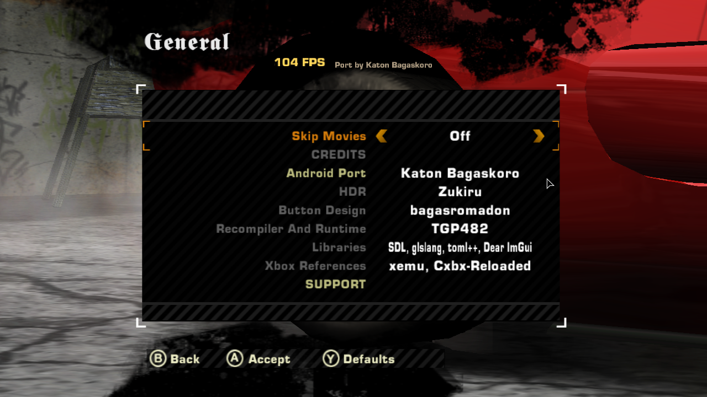

# Need for Speed: Most Wanted (Black Edition) — Native Linux Port

[](https://github.com/Katon17/nfsmw-linux/releases)
[](https://kernel.org)
[](https://linuxmint.com)
[](https://www.vulkan.org/)
[](https://libsdl.org)
[](https://github.com/TGP482/XboxXBE-Recomp)
[](#-verified-performance--system-specifications)
[](https://saweria.co/Kabako)

A high-performance, native Linux desktop port and `.deb` packaging of **Need for Speed: Most Wanted (Black Edition)** (2005, original Xbox), maintained by [Katon Bagaskoro (@Katon17)](https://github.com/Katon17), based on [RanggaCasper's MostWanted-Android](https://github.com/RanggaCasper/MostWanted-Android) and [TGP482's XboxXBE-Recomp](https://github.com/TGP482/XboxXBE-Recomp).

---

## 📸 Screenshots

| Main Menu (121 FPS on ThinkPad X270) | General & Credits Menu (104 FPS) |
|:---:|:---:|
|  |  |

| Gameplay Prologue Race (Locked 61 FPS) | Lenovo ThinkPad X270 Hardware Specs |
|:---:|:---:|
|  |  |

---

## ⚡ Why This Native Port?

Traditional methods for running classic console games on Linux suffer from severe performance overhead:
- **Emulators (Xemu, RPCS3, PCSX2)**: Emulate the CPU instruction by instruction and simulate GPU registers in software loops. On budget dual-core laptops like the **ThinkPad X270 (Intel Core i5/i7 7th Gen, Intel HD 620)**, emulators choke to 15–25 FPS with choppy sound.
- **Wine / Proton**: Introduce DXVK translation layers, Windows API shims, and heavy background memory consumption.

**`nfsmw-linux` takes a pure native recompilation approach**:
1. **Static Recompilation**: Directly translates original Xbox x86 assembly instructions from `default.xbe` into modern C++ code ahead of time.
2. **Direct Vulkan 1.1 Host**: Translates Direct3D 8 draw calls, DirectSound streams, and kernel synchronization primitives directly into bare-metal **Vulkan 1.1**, **SDL3 audio**, and Linux POSIX threads.
3. **No Emulation Layer**: Executes as a true native 64-bit Linux ELF binary (`x86_64`) on bare metal.
4. **100+ FPS on Low-End Laptops**: Delivers butter-smooth frame rates and responsive controls even on 15W low-power integrated graphics (Intel HD 620).

---

## 🆕 What's New & Changelog

### Version 0.1.4 (Latest)
- **Tautan Resmi Pengembang (Support & Media)**:
  - Menu **General > SUPPORT** kini langsung terhubung ke profil resmi [Katon Bagaskoro](https://github.com/Katon17):
    - **DONATE**: [Saweria (saweria.co/Kabako)](https://saweria.co/Kabako)
    - **GITHUB**: [Katon17/nfsmw-linux](https://github.com/Katon17/nfsmw-linux)
    - **YOUTUBE**: [@KabakoNT (youtube.com/@KabakoNT)](https://www.youtube.com/@KabakoNT)
- **Fitur Baru "EXIT GAME" (Keluar Game)**:
  - Menambahkan menu `EXIT GAME` di dalam opsi **General** dan overlay **F10** untuk menutup permainan secara bersih ke desktop Linux (mem-flush log, membebaskan memori Vulkan/SDL3 tanpa meninggalkan proses *zombie*).
  - Tersedia terjemahan otomatis dalam Bahasa Indonesia (`Keluar Game` ➔ `Keluar`) dan berbagai bahasa lainnya.
- **Kredit Tim (Dual Port Credits)**:
  - Menyempurnakan daftar **Credits** dengan mengapresiasi **Rangga Casper** sebagai pembuat port Android asal, dan **Katon Bagaskoro** sebagai pengembang port native Linux.
- **Tampilan Antarmuka Khusus Linux (Linux Options & Tux Icon)**:
  - Opsi di menu utama kini bertuliskan **"Linux Options"** (atau **"Opsi Linux"**).
  - Mengganti ikon robot Android dengan ikon custom **Tux the Linux Penguin** bersanding dengan roda gigi pengaturan dalam gaya monokrom khas Need for Speed.
- **Perbaikan Masalah Linking Step `[3/3]` (Ernawan's Fix)**:
  - Mengimplementasikan *weak symbols* (`__attribute__((weak))`) dan argumen linker `-Wl,--allow-multiple-definition`.
  - Menghilangkan sepenuhnya error *duplicate symbol* maupun *undefined symbol* (`input::PadActions`, `host::SamplePerf`).
- **Perbaikan Freeze / Stuck Loading Prologue Race 2 (Yokaiju's Fix)**:
  - Mengatasi *deadlock* Vulkan fence saat transisi balapan mengalahkan SLR McLaren hitam (Bull) dengan pembatasan timeout 5 detik (`kGpuWaitTimeoutNs`).
  - Mengganti `Destroy(down)` menjadi `Retire(down)` agar tekstur transfer in-flight tidak terhapus prematur saat GPU masih membaca data.
  - Mengaktifkan fitur lewati video cutscene transisi secara manual kapan saja dengan tombol **Enter** atau **Spacebar** / Controller **A**.
  - Membersihkan partisi scratch cache sementara Xbox (`hdd/X`, `hdd/Y`, `hdd/Z`) secara otomatis pada setiap boot game tanpa menyentuh progress save karier (`hdd/E/UDATA`).

---

## 📊 Verified Performance & System Specifications

### Real-World Testbed Benchmark
Tested on real hardware by **Katon Bagaskoro**:
* **Laptop**: Lenovo ThinkPad X270
* **CPU**: Intel® Core™ i7-7600U @ 2.80GHz (2 Cores / 4 Threads, 15W ULV)
* **GPU**: Intel® HD Graphics 620 (Mesa Vulkan driver)
* **RAM**: 8 GB DDR4
* **OS**: Linux Mint 22.3 (XFCE 64-bit, Kernel 6.8 / 7.0)
* **In-Game Performance**: **104 – 121 FPS di Menu, Locked 60 – 61 FPS di Gameplay** pada resolusi native dengan zero stuttering, zero audio crackles, dan respons input instan.

---

### Hardware Requirements

Based on empirical testing on the ThinkPad X270, here are the minimum and recommended hardware requirements:

| Specification | Minimum (30–45 FPS Playable) | Recommended (60–120 FPS Locked) |
|---|---|---|
| **Operating System** | Linux Mint 21/22, Ubuntu 22.04/24.04, Debian 12, Arch, Fedora | Linux Mint 22.3 XFCE / Ubuntu 24.04 LTS (x86_64) |
| **Processor (CPU)** | Intel Core i3 4th Gen (Haswell) / Celeron G3900 / AMD Athlon 200GE *(Must support `x86-64-v2` / SSE4.2)* | Intel Core i5 / i7 6th or 7th Gen (e.g. i7-7600U, i5-7200U) or AMD Ryzen 3 2200U / Ryzen 5 |
| **Graphics (GPU)** | Intel HD Graphics 4400 / 520, AMD Radeon R5 / HD 7000, NVIDIA GT 730 *(Vulkan 1.1 support required)* | Intel HD Graphics 620 / Intel Iris Xe / AMD Vega 3+ / NVIDIA GeForce 940MX or dedicated GPU |
| **RAM** | 4 GB | 8 GB (accelerates initial 1-time C++ compilation) |
| **Storage** | ~4 GB available space (game data + cache) | SSD storage recommended |

---

## 🚀 Quick Install (Debian / Linux Mint / Ubuntu)

No terminal expertise required. Installing is completely automated:

### 1. Download & Install the `.deb` Package
Download the latest **`nfsmw-linux_0.1.4_amd64.deb`** from the [GitHub Releases](https://github.com/Katon17/nfsmw-linux/releases) page:

* **GUI Option**: Double-click the downloaded `.deb` file and click **Install Package** in GDebi or Software Manager.
* **Terminal Option**:
  ```bash
  sudo apt install ./nfsmw-linux_0.1.4_amd64.deb
  ```

All required dependencies (`libvulkan1`, `mesa-vulkan-drivers`, `clang`, `lld`, `zenity`, `python3`) are installed automatically.

### 2. Launch & Select Your ISO
1. Open your desktop application menu: **Menu ➔ Games ➔ Need for Speed: Most Wanted**.
2. A file selection dialog will pop up: select your original Xbox ISO disc image of **Need for Speed: Most Wanted (Black Edition - USA)**.
3. The automated builder will:
   - Extract `default.xbe` using the built-in XDVDFS reader.
   - Recompile the 28,848 game functions into C++.
   - Compile the modules and link the native Linux executable.
   - Auto-configure optimal WASD racing controls.
4. The game launches immediately!

*(Subsequent launches open in 2 seconds directly into the game without recompiling).*

---

## 🎮 Controls

### Keyboard (Pure PC WASD Racing Scheme)

The controls are pre-configured out-of-the-box to match the canonical PC Need for Speed layout without conflicting keys:

| Action | Key | Description |
|---|:---:|---|
| **Throttle / Accelerate** | `W` | Primary gas pedal (Right Trigger) |
| **Brake / Reverse** | `S` | Foot brake and reverse (Left Trigger) |
| **Steer Left** | `A` | Turn wheels left (Analog stick) |
| **Steer Right** | `D` | Turn wheels right (Analog stick) |
| **Handbrake / Drift** | `Spacebar` | E-brake for power slides and tight hairpins |
| **Nitrous (NOS)** | `Left Shift` | Nitrous oxide boost |
| **Speedbreaker** | `X` | Bullet-time slow motion |
| **Look Back (Rear View)** | `C` | Look behind car |
| **Change Camera** | `V` | Switch between Bumper, Hood, Chase Close, and Chase Far |
| **Horn** | `H` | Honk horn |
| **Reset Car** | `R` | Reset vehicle onto road |
| **Pause Game** | `Escape` | Pause menu |
| **Navigate Menus** | `Arrow Keys` | Browse menu options safely |
| **Select / Enter** | `Enter` | Confirm selection |
| **Port Settings Menu** | `F10` | In-game overlay menu (rebind keys, view FPS, adjust graphics) |

### Gamepads (Xbox, PlayStation, Generic USB)
Plug-and-play controller support via SDL3:
- **Gas / Accelerate**: Right Trigger (`RT` / `R2`)
- **Brake / Reverse**: Left Trigger (`LT` / `L2`)
- **Steer**: Left Analog Stick
- **Handbrake**: `A` (Xbox) / `Cross` (PlayStation)
- **Nitrous**: `B` (Xbox) / `Circle` (PlayStation)
- **Speedbreaker**: `X` (Xbox) / `Square` (PlayStation)
- **Look Back**: `Y` (Xbox) / `Triangle` (PlayStation)
- **Pause**: `Start` / `Options`

---

## 🛠️ Building from Source

If you want to modify the host runtime or build from source:

```bash
# 1. Clone repository
git clone https://github.com/Katon17/nfsmw-linux.git
cd nfsmw-linux

# 2. Build host library, recompiler, and package
./build-from-source.sh --deb
```

The resulting package will be generated at `release/nfsmw-linux_0.1.4_amd64.deb`.

---

## 🔧 Troubleshooting & Solusi Masalah Populer

### 1. Linking Gagal pada Step `[3/3]` (`undefined symbol` / `duplicate symbol`)
* **Penyebab**: Terjadi konflik simbol stub antara library host dan linker pada sistem tertentu.
* **Solusi di v0.1.4**: Seluruh stub input dan host telemetry telah di-bake secara internal langsung di `libnfsmw_host.a` dengan *weak symbols* dan linker flag `--allow-multiple-definition`. Cukup install update:
  ```bash
  sudo dpkg -i nfsmw-linux_0.1.4_amd64.deb
  nfsmw-linux --rebuild
  ```

### 2. Freeze / Stuck Loading setelah Mengalahkan SLR McLaren Hitam (Prologue Race 2)
* **Penyebab**: 
  1. Vulkan Fence deadlock (`UINT64_MAX` menunggu GPU tak terhingga saat transisi FMV/cutscene ke race berikutnya).
  2. Partisi cache sementara Xbox (`hdd/X`, `hdd/Y`, `hdd/Z`) menyimpan dump sementara yang korup saat transisi loading.
  3. Pemutaran FMV transisi tidak merespons tombol lewati (*skip*).
* **Solusi di v0.1.4**:
  - Vulkan fence timeout dibatasi maksimal 5 detik (`kGpuWaitTimeoutNs`) untuk mencegah GPU hang tanpa henti.
  - Penanganan transfer image Vulkan di-upgrade ke `Retire(down)` agar tekstur in-flight tidak terhapus prematur.
  - Cutscene transisi kini dapat dilewati secara manual kapan saja dengan menekan **Enter** atau **Spacebar** / Gamepad **A**.
  - Partisi scratch cache Xbox (`X`, `Y`, `Z`) dibersihkan otomatis pada setiap boot game tanpa menyentuh progress save karier (`hdd/E/UDATA`).
  - Pembersihan cache shader manual dapat dijalankan dengan:
    ```bash
    nfsmw-linux --clean-cache
    ```

---

## 📁 File Locations

* **Game Saves & Career Profiles**: `~/.local/share/nfsmw-linux/hdd/` (Xbox virtual storage, safe across updates)
* **Configuration File**: `~/.local/share/nfsmw-linux/mostwanted.toml`
* **Vulkan Shader Cache**: `~/.local/share/nfsmw-linux/mesa_cache/`
* **Compiled Game Binary**: `~/.local/share/nfsmw-linux/bin/MOSTWANTED`

---

## ☕ Support & Donations

Jika proyek ini bermanfaat bagi Anda dan komunitas Linux gaming, Anda dapat mendukung pengembangannya melalui:
* 💰 **Saweria**: [saweria.co/Kabako](https://saweria.co/Kabako)
* 📺 **YouTube**: [@KabakoNT](https://www.youtube.com/@KabakoNT)
* ⭐ **GitHub Star**: [Katon17/nfsmw-linux](https://github.com/Katon17/nfsmw-linux)

---

## 📜 Credits & Acknowledgements

* **Linux Desktop Maintainer**: [Katon Bagaskoro (@Katon17)](https://github.com/Katon17)
* **Upstream Android Host Runtime**: [RanggaCasper/MostWanted-Android](https://github.com/RanggaCasper/MostWanted-Android)
* **Xbox Static Recompiler**: [TGP482/XboxXBE-Recomp](https://github.com/TGP482/XboxXBE-Recomp)
* **SpeedBreaker Project**: [SpeedBreakerProject/speedbreaker](https://github.com/SpeedBreakerProject/speedbreaker)
* **Libraries**: [SDL3](https://github.com/libsdl-org/SDL), [glslang](https://github.com/KhronosGroup/glslang), [Dear ImGui](https://github.com/ocornut/imgui), [toml++](https://github.com/marzer/tomlplusplus), [Zydis](https://github.com/zyantific/zydis).

*Disclaimer: Need for Speed™ and Need for Speed: Most Wanted are registered trademarks of Electronic Arts Inc. This is an unofficial, non-commercial open-source preservation project. No copyrighted EA binaries or assets are distributed.*
